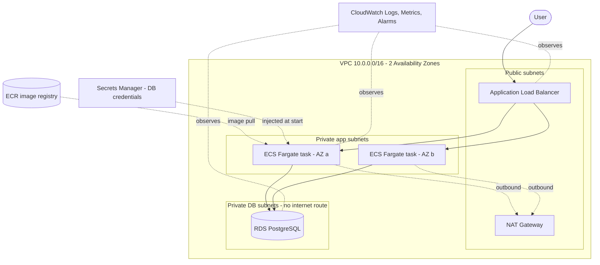
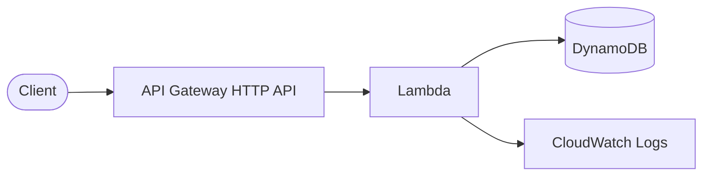
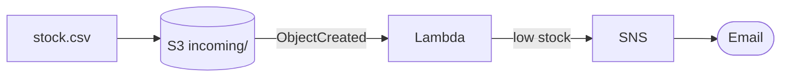
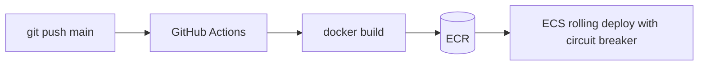

# Architecture

## Project 03: Three-tier platform

## Project 01: Serverless shipment tracker

## Project 02: Inventory alerts

## CI/CD

## Approximate monthly cost (verify with the AWS Pricing Calculator; prices vary by region)

| Project | Main cost drivers | Rough idea |
|---|---|---|
| 01 Serverless tracker | Lambda, API Gateway, DynamoDB on-demand | Near zero at demo traffic (free tier) |
| 02 Inventory alerts | S3, Lambda, SNS | Near zero |
| 03 Platform | NAT Gateway, ALB, 2 Fargate tasks, RDS | The expensive one: tens of USD/month if left running. **Destroy after demo.** |
| 04 Observability | Dashboard, alarms, logs | A few USD |

## Well-Architected mapping

| Pillar | Where |
|---|---|
| Security | SG chaining, private DB tier, Secrets Manager, least-privilege IAM, encryption, blocked public S3 |
| Reliability | Multi-AZ subnets, ALB health checks, auto scaling, circuit breaker rollback, DynamoDB PITR, RDS backups |
| Performance efficiency | Serverless for spiky load, Fargate right-sizing, HTTP API instead of REST API |
| Cost optimization | On-demand DynamoDB, single NAT option, ECR lifecycle policy, log retention, budget alerts |
| Operational excellence | Terraform for everything, CI/CD, dashboard + alarms |

## Interview talking points
1. "Why is `/health` not checking the database?" A DB outage would make the ALB kill every healthy container and turn a partial outage into a full one. Liveness and readiness are separate endpoints.
2. "Why a separate execution role and task role?" The execution role is for ECS plumbing (pull image, read one secret). The app code gets its own role, which is empty because it needs no AWS API access.
3. "How do you handle secrets?" RDS generates and stores the password in Secrets Manager; ECS injects it at container start. It never appears in code or Terraform variables.
4. "What would you change for production?" HTTPS with ACM, Multi-AZ RDS, NAT per AZ, remote Terraform state, WAF in front of the ALB, final snapshots and deletion protection.
5. "Why serverless for tracking but containers for the platform?" Spiky, simple CRUD fits Lambda; steady traffic with a relational database and longer-running logic fits containers.
